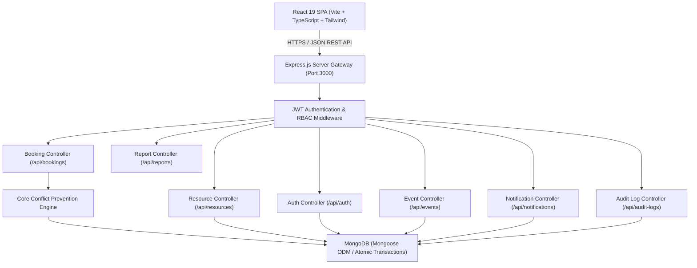
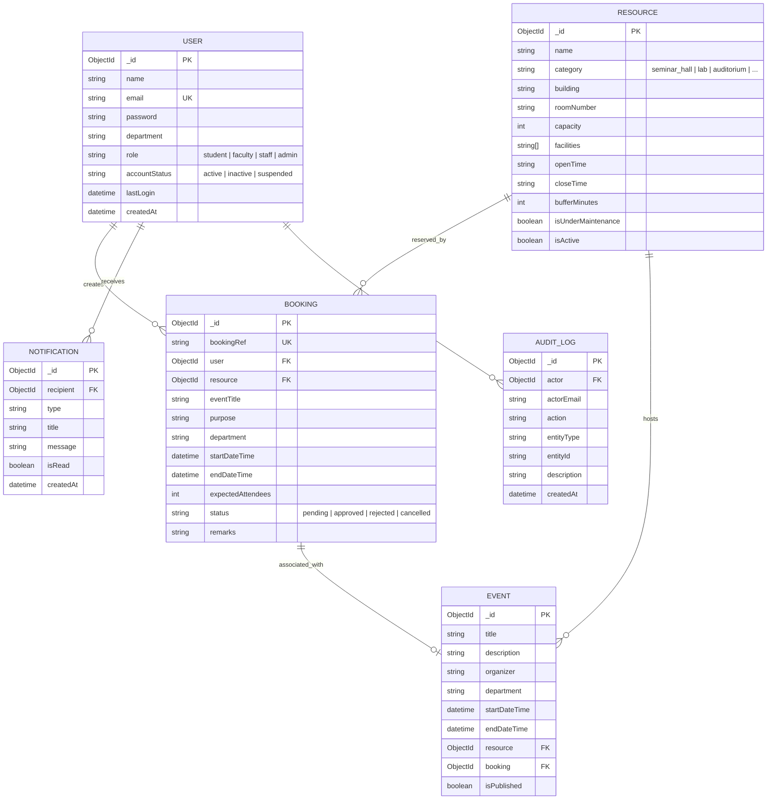
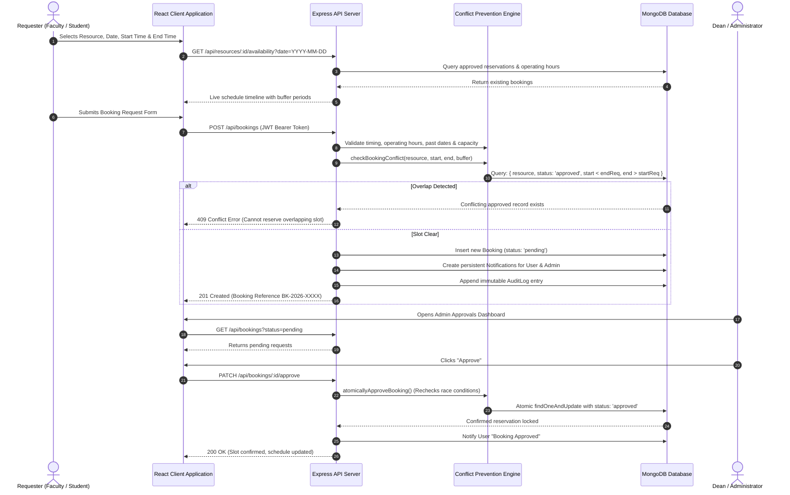

# Academic Event and Resource Booking Portal
## Comprehensive Final-Year Project Report & Technical Specification

---

## 1. Project Abstract
The **Academic Event and Resource Booking Portal** is an enterprise-grade full-stack web application designed for universities and tertiary academic institutions. The system centralizes the reservation lifecycle for shared institutional resources—including tiered seminar amphitheaters, high-performance computing laboratories, convocation auditoriums, smart classrooms, and audio-visual assets. 

By replacing manual paper registers, ad-hoc spreadsheets, and disjointed email chains, the portal eliminates double-bookings through a server-authoritative **Conflict Prevention Engine** adhering to the mathematical **half-open interval theorem** ($start_A < end_B \land end_A > start_B$) and atomic concurrency protection. Built on the modern MERN stack (MongoDB, Express.js, React 19 with Vite & TypeScript, and Node.js), it enforces strict Role-Based Access Control (RBAC) separating student scholars, faculty investigators, facilities staff, and administrative deans.

---

## 2. System Architecture & High-Level Design

---

## 3. Entity-Relationship (ER) Diagram

---

## 4. Data-Flow Diagram (DFD Level-1)

---

## 5. Mathematical Conflict Prevention Engine

Double-bookings are the single most critical failure mode in campus resource portals. The engine operates on three mathematical pillars:

### A. The Half-Open Interval Overlap Theorem
Two time intervals $[start_A, end_A)$ and $[start_B, end_B)$ overlap if and only if:
$$\text{Overlap}(A, B) \iff start_A < end_B \quad\land\quad end_A > start_B$$

For an existing approved reservation $B$ and a requested reservation $A$, any non-zero intersection violates availability.

### B. Changeover Buffer Time Extension
Academic institutions require a cleaning and AV recalibration period between consecutive meetings:
$$start_B^{\text{effective}} = start_B - \Delta_{\text{buffer}}$$
$$end_B^{\text{effective}} = end_B + \Delta_{\text{buffer}}$$
The query validates:
$$\text{startDateTime} < (end_B + \Delta_{\text{buffer}}) \quad\land\quad \text{endDateTime} > (start_B - \Delta_{\text{buffer}})$$

Adjacent bookings ($end_A == start_B$) without buffer or with satisfied buffer intervals are explicitly permitted.

### C. Atomic Concurrency & Race-Condition Defense
If two administrators attempt to approve separate pending requests for overlapping intervals simultaneously:
1. `atomicallyApproveBooking` executes a serial verification immediately preceding status modification.
2. The second transaction observes the newly approved slot and rejects the transition with HTTP 409 Conflict.

---

## 6. Comprehensive API Endpoint Reference

| Method | Endpoint | Access Level | Description |
| :--- | :--- | :--- | :--- |
| **POST** | `/api/auth/register` | Public | Register new student, faculty, or staff account |
| **POST** | `/api/auth/login` | Public | Authenticate user credentials & issue JWT |
| **GET** | `/api/auth/me` | Authenticated | Retrieve authenticated user session profile |
| **PATCH** | `/api/auth/profile` | Authenticated | Update name, department, or change password |
| **POST** | `/api/auth/forgot-password` | Public | Request password reset token |
| **POST** | `/api/auth/reset-password` | Public | Reset security password with verification token |
| **GET** | `/api/resources` | Public / All | Browse and filter campus facilities |
| **GET** | `/api/resources/:id` | Public / All | Get detailed specifications for a venue |
| **GET** | `/api/resources/:id/availability` | Public / All | Get hourly schedule and occupied intervals |
| **POST** | `/api/resources` | Admin Only | Register a new campus venue |
| **PATCH** | `/api/resources/:id` | Admin Only | Edit venue capacity, hours, or facilities |
| **PATCH** | `/api/resources/:id/maintenance` | Admin Only | Toggle maintenance closure with reason |
| **DELETE** | `/api/resources/:id` | Admin Only | Delete venue (blocked if active bookings exist) |
| **POST** | `/api/bookings` | Authenticated | Submit new reservation with conflict precheck |
| **GET** | `/api/bookings/my` | Authenticated | Retrieve requester's own reservation history |
| **GET** | `/api/bookings/:id` | Authenticated | View detailed dossier with status history |
| **PATCH** | `/api/bookings/:id/cancel` | Owner / Admin | Cancel reservation & immediately release slot |
| **GET** | `/api/bookings` | Admin Only | View all campus bookings with multi-filters |
| **PATCH** | `/api/bookings/:id/approve` | Admin Only | Atomically revalidate and approve booking |
| **PATCH** | `/api/bookings/:id/reject` | Admin Only | Decline booking with mandatory justification |
| **GET** | `/api/events` | Public / All | View published institutional events |
| **POST** | `/api/events` | Faculty / Admin | Publish official campus event announcement |
| **GET** | `/api/notifications` | Authenticated | Fetch persistent in-app notifications |
| **PATCH** | `/api/notifications/:id/read` | Authenticated | Mark notification as read |
| **GET** | `/api/reports/overview` | Admin Only | Real-time aggregate KPI metrics |
| **GET** | `/api/reports/analytics` | Admin Only | Department utilization, peak hours, trends |
| **GET** | `/api/reports/export` | Admin Only | Stream dynamic CSV file of all reservations |
| **GET** | `/api/audit-logs` | Admin Only | Search immutable security and admin action logs |

---

## 7. Security Architecture & Threat Modeling

1. **Password Hashing**: Bcrypt with work factor salt of 10. Passwords are never returned in database projections (`select: false`).
2. **Stateless JWT Tokens**: Signed with HMAC SHA-256 (`JWT_SECRET`) containing user ID, role, and department. Validated via Bearer header.
3. **Defense Against Privilege Escalation**: Public registration rejects `role: 'admin'`. Admin routes strictly enforce `authorize('admin')`.
4. **Ownership Verification**: Requester users can only view and cancel their own bookings.
5. **NoSQL Injection Prevention**: Mongoose strict schema casting sanitizes input objects.
6. **Deletion Safeguards**: Resources with upcoming confirmed bookings cannot be deleted until reservations are reassigned or cancelled.

---

## 8. Final-Review Viva Questions and Answers

### Q1: How does your system mathematically prevent double-bookings?
**A:** We implement the Half-Open Interval Overlap Theorem: $start_A < end_B \land end_A > start_B$. In MongoDB, we construct a compound index `{ resource: 1, status: 1, startDateTime: 1, endDateTime: 1 }`. When a booking is submitted or approved, we query for any approved reservation for the same resource where the start is before the requested end and the end is after the requested start. In addition, we expand the window by the resource's `bufferMinutes` to guarantee changeover periods.

### Q2: How does the system handle concurrent approval attempts for conflicting requests?
**A:** The `atomicallyApproveBooking` service executes a critical atomic revalidation query right before flipping the status to `approved`. If Administrator A and Administrator B simultaneously attempt to approve overlapping requests, only the first transaction commits; the second receives an explicit 409 Conflict explaining that the time slot was committed milliseconds prior.

### Q3: Why is password hashing performed in a pre-save hook?
**A:** To ensure that passwords are automatically hashed consistently before persisting to MongoDB, preventing plaintext credentials from ever reaching the storage layer. We also set `select: false` on the password attribute in Mongoose so API queries never leak hashes.

### Q4: How does the architecture separate normal user and admin modules?
**A:** Separation is enforced at both the client and server levels. On the backend, `authorize('admin')` middleware blocks non-admin JWTs. On the client, React Router wraps admin routes in an `AdminRoute` component and switches the navigation sidebar between Requester Workspace and Administration Suite.

---

## 9. Demonstration Script for Examiners

1. **Phase 1: Public Discovery & Venue Catalog**
   - Navigate to `/` (Landing Page). Inspect campus architecture hero banner and key KPI stats.
   - Go to `/resources`. Search for "Laser" or filter by "Seminar Halls".
   - Open "Alan Turing Executive Amphitheater". Inspect installed equipment, operating hours, and live availability timeline.
2. **Phase 2: Conflict Prevention Demonstration**
   - Click "Fast Demo Sign-In" as **Alex Rivera (Student)**.
   - Click "Request Booking". Try selecting a time slot that overlaps with the existing approved keynote (10:00 AM - 12:30 PM). Notice the real-time conflict warning banner.
   - Change the slot to an available time (e.g., 2:00 PM - 4:00 PM). Submit the booking. Receive reference number `BK-2026-XXXX`.
3. **Phase 3: Administrative Approval & Revalidation**
   - Use the **Demo Switcher** in the navbar to switch to **Dr. Arthur Vance (Dean / Admin)**.
   - Navigate to `/admin/approvals`. Observe the newly submitted request in the "Pending Review" queue.
   - Click "Approve". Enter dean remarks and confirm. The conflict engine revalidates availability and commits the approval.
4. **Phase 4: Reports, Analytics & Audit Trails**
   - Go to `/admin`. Inspect Recharts charts displaying bookings by department and peak booking hours.
   - Go to `/admin/reports`. Click "Download CSV Export" to generate the institutional CSV report.
   - Go to `/admin/audit-logs`. View the logged audit entries for login, creation, and approval actions with timestamps.
